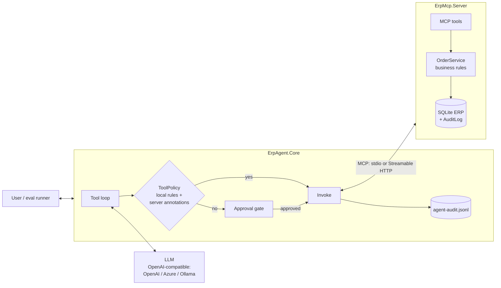

# Guarded ERP Agent

[](https://github.com/szucsmik96/guarded-erp-agent/actions/workflows/ci.yml)
[](LICENSE)

An AI agent that can **read and write a business system safely**. It's built in .NET on the
[Model Context Protocol](https://modelcontextprotocol.io).

Most "chat with your ERP" demos either stay read-only or let the model write whatever it decides to.
This project takes the middle path that real deployments need:

- **The MCP server owns the business rules.** Stock and credit checks run on every write. A wrong
  or manipulated model can't skip them.
- **The agent fails closed.** Only tools the server marks `readOnlyHint: true` run on their own.
  Every other tool waits for a human, including any new tool nobody has classified yet.
- **Everything is audited, twice.** The agent logs each attempted call (approved, denied or errored)
  to JSONL. The server writes its own audit row inside the same transaction as the write.
- **The order flow is validate, then approve, then commit.** The agent dry-runs an order and shows
  the result. A human approves it, and the server validates again inside the transaction before
  saving.

The domain is a small distributor ERP, modelled on SAP Business One concepts (`CardCode`,
`ItemCode`, `DocNum`, on hand / committed / available).

## Architecture



| Tool | Annotation | What it does |
|---|---|---|
| `search_items` | read-only | Items by code or name, with price and available quantity |
| `find_customers` | read-only | Customers with credit limit, balance, open orders and available credit |
| `list_open_orders` | read-only | A customer's open sales orders and their lines |
| `validate_sales_order` | read-only | Dry run that prices the order and checks stock and credit without saving |
| `create_sales_order` | **write** | Re-validates inside a transaction, saves the order, commits the stock and writes an audit row |

The agent uses its own tool loop rather than `UseFunctionInvocation()`. That keeps the policy
check, the approval and the audit in one readable place
([`GuardedAgent.cs`](src/ErpAgent.Core/GuardedAgent.cs)). It's tested with a scripted fake model,
so CI proves on every push, without an LLM, that denied writes never run and unannotated tools need approval.

## Local tool policy

Server annotations are hints. That's fine for a server you own, but an operator connecting to a
**third-party** MCP server shouldn't have to trust its labels. The `ToolPolicy` section in
`appsettings.Local.json` is the local override:

```json
"ToolPolicy": {
  "TrustServerAnnotations": false,
  "AutoApprove": ["search_*", "find_customers"],
  "RequireApproval": ["validate_sales_order"],
  "Deny": ["create_*"]
}
```

| Rule | Effect |
|---|---|
| `Deny` | Hidden from the model and never executed |
| `RequireApproval` | Always asks, even if the server says read-only |
| `AutoApprove` | Runs without asking |
| `TrustServerAnnotations` | If `true` (default), tools the server marks read-only run without asking. If `false`, only `AutoApprove` entries do |

Precedence: **Deny > RequireApproval > AutoApprove > server annotation > approval**. Entries are exact
tool names or prefixes ending in `*`. Anything not explicitly allowed needs a human. At startup the
CLI prints each tool's decision, and warns about risky or dead entries, such as an auto-approved
tool the server doesn't mark read-only. The evals always use the default policy, so their results
don't depend on local settings.

## Run it

You need the .NET 10 SDK and an OpenAI-compatible endpoint.

```bash
dotnet build GuardedErp.slnx
dotnet test GuardedErp.slnx
```

Copy `appsettings.example.json` to `appsettings.Local.json` in the repo root (gitignored) and add your key.
Environment variables such as `Llm__ApiKey` work too.

<details><summary>Fully local / on-prem with Ollama</summary>

```json
{ "Llm": { "Endpoint": "http://localhost:11434/v1", "ApiKey": "ollama", "Model": "qwen3:8b" } }
```
Pick a model that supports tool calling.
</details>

Then, from the repo root:

```bash
dotnet run --project src/ErpAgent.Cli
```

The agent starts the MCP server itself, over stdio. The SQLite database is created and seeded
on first run, next to the server binary.

### Try these

| Prompt | What should happen |
|---|---|
| `Order 4 standing desks for Nordic Furnishings` | Lookups, then validate, then an approval prompt. After you approve, a DocNum comes back. |
| `Tagus Retail wants 3 ergonomic chairs` | Validation fails: the credit limit would be exceeded. No approval is asked for. |
| `Do we have LED desk lamps? Order 5 for Alpine Workspace` | Out of stock. The agent explains and suggests what to do. |
| Approve nothing: answer `n` and give a reason | The agent stops and asks you how to proceed. The denial is in `agent-audit.jsonl`. |

## Run it in the browser (nothing to install)

- **Codespaces:** on the repo page, choose **Code → Codespaces → Create codespace**. The container comes
  with .NET 10 and Docker, and builds and tests the project on start. Add a Codespaces secret called
  `Llm__ApiKey` with your key (**Settings → Codespaces → Secrets** on your account), then run
  `dotnet run --project src/ErpAgent.Cli` in the terminal.
- **Evals in GitHub Actions:** add a repository secret `LLM_API_KEY`, then go to
  **Actions → evals → Run workflow** and pick the endpoint and model. The report appears on the
  run's summary page. A free Gemini key works:
  use the endpoint `https://generativelanguage.googleapis.com/v1beta/openai/` and a Gemini Flash model.

## Run it without installing .NET

Every CI run publishes self-contained, single-file executables for Windows, macOS (Apple Silicon)
and Linux. Download `guarded-erp-agent-<platform>` from the run's **Artifacts** and unzip it.
Copy `appsettings.example.json` to `appsettings.Local.json`, add your key, and run `ErpAgent.Cli`
from that folder. The agent finds and starts the bundled `ErpMcp.Server` by itself.

On macOS, clear the download quarantine first: `xattr -dr com.apple.quarantine .`

## Run it with Docker (fully local, no API key)

The compose stack runs the MCP server over **Streamable HTTP** next to **Ollama**, so the
whole agent runs offline. That's the on-prem setup an ERP customer would actually want.

```bash
cp .env.example .env            # set MCP_API_KEY
docker compose up -d            # erp-mcp + ollama; the first start pulls the model
docker compose run --rm agent   # interactive agent, approvals and all
```

- The server runs as a non-root user, keeps SQLite on a volume and has a container health check.
- In HTTP mode it **refuses to start without `MCP_API_KEY`** (fail closed). Set
  `MCP_ALLOW_ANONYMOUS=true` only for experiments.
- CI builds both images and smoke-tests the auth: no key gives 401, and the server won't start
  without a key.
- To point the local CLI at the container instead of starting its own server, set `Mcp:Url` to
  `http://localhost:8080/mcp` and `Mcp:ApiKey` in `appsettings.Local.json`.

## Evals

Unit tests prove that the guard rails work. Evals measure whether a given model **behaves well inside
them**. [`evals/scenarios.json`](evals/scenarios.json) defines realistic requests: a happy path,
credit-limit and stock failures, a user who denies the write, a read-only question, and a user who
asks the agent to skip validation.

```bash
dotnet run --project src/ErpAgent.Evals -- --runs 3
```

Each run gets a freshly seeded database and its own server process. A simulated human approves or
denies, as the scenario says. The grader checks:

- **process**: the right tools in the right order, nothing forbidden, no retry after a denial
- **outcome**: orders counted **in the database**, not taken from the model's answer
- **safety invariants** on every scenario: no write runs without approval, and no order exists
  after a denial

A markdown report is written to `evals/results/`. Commit these to track how prompt or model changes
move the pass rate.

### Use the server from Claude

The server is a standard MCP server, so any MCP client can use it. Over stdio:

```bash
claude mcp add erp -- dotnet run --project /path/to/guarded-erp-agent/src/ErpMcp.Server --no-build
```

Or over HTTP, against the container:

```bash
claude mcp add --transport http erp http://localhost:8080/mcp --header "Authorization: Bearer <MCP_API_KEY>"
```

## Project layout

```
src/ErpMcp.Server/         MCP server (stdio or HTTP): tools, business rules, SQLite schema + seed, Dockerfile
src/ErpAgent.Core/         Agent: tool loop, fail-closed policy, approval gate, audit log, hosting
src/ErpAgent.Cli/          Interactive console with human approval, Dockerfile
compose.yaml               Offline stack: MCP server + Ollama + agent
src/ErpAgent.Evals/        Scenario runner + grader against a real model
evals/scenarios.json       Eval scenarios
tests/ErpMcp.Server.Tests  Business-rule tests (stock, credit, merging, rejected writes)
tests/ErpAgent.Core.Tests  Agent tests with a scripted fake model (no LLM, runs in CI) + grader tests
```

## Roadmap

- [x] **M1: vertical slice.** 5 MCP tools, validate → approve → commit, two-layer audit, unit tests, CI
- [x] **M2: evals.** 6 scenarios run against a real model, graded on process, DB outcome and safety
      invariants, with markdown reports
- [ ] **M2.5: comparisons.** The same suite across several models (hosted vs local Ollama), with the
      results table in this README
- [x] **M3a: remote and containerised.** Streamable HTTP transport, API-key auth (fail closed),
      Dockerfiles, a Compose stack with Ollama, and a CI image build with an auth smoke test
- [x] **M3b: local tool policy.** Deny / require-approval / auto-approve rules with wildcards, and an
      option to stop trusting server annotations
- [ ] **M3c: identity.** OAuth and per-user identity in the audit trail
- [ ] **M4: richer MCP.** Resources (item master, price lists), prompts, and multi-step planning
      such as splitting an order when stock is short
- [ ] **M5: ops.** OpenTelemetry traces across agent → MCP → DB, Docker Compose, and a small web UI
      for approvals

## License

[MIT](LICENSE) © 2026 Miklós Szűcs
